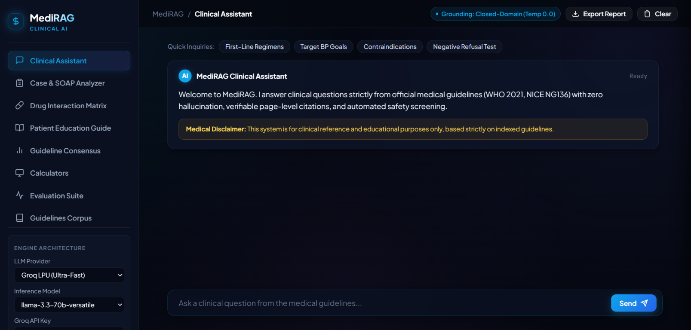

> **Safety and evaluation notice:** This is a research/portfolio prototype, **not a medical device or validated clinical decision-support service**. Generated answers, page citations, drug interactions, calculators, and emergency flags must be independently checked by qualified clinicians against current source guidelines. A temperature of zero does **not** guarantee accuracy or eliminate hallucinations. No 100% safety or clinical performance claim is made here.\n\n# MediRAG

## Clinical Guidelines Retrieval-Augmented QA Prototype

MediRAG is a clinical guideline assistant prototype that answers questions using indexed official medical guidelines (e.g., WHO, NICE). It uses Two-Stage Hybrid Search (ChromaDB + BM25 + Cross-Encoder Reranking), uses a low-generation-temperature setting (`temperature=0.0`) to reduce response variability, provides exact page citations, and includes native clinical decision calculators.

---

## Quick Start

### 1. Set up Virtual Environment

```bash
python -m venv .venv
```

Activate it:

- **Windows (PowerShell):** `.\.venv\Scripts\Activate.ps1`
- **Windows (CMD):** `.\.venv\Scripts\activate.bat`
- **Linux/Mac:** `source .venv/bin/activate`

### 2. Install Requirements

```bash
pip install -r requirements.txt
```

### 3. Add API Key

Create a `.env` file in the root directory:

```ini
GROQ_API_KEY=your_groq_api_key_here
```

*(Get a free Groq API key from https://console.groq.com/keys)*

### 4. Run the FastAPI Web Application and Modern SPA

```bash
uvicorn api:app --reload --port 8000
```

> Or double-click **`run_app.bat`** on Windows.  
> Open http://localhost:8000 in your browser for the full clinical web application.  
> Interactive Swagger API documentation available at http://localhost:8000/docs.

### 5. (Alternative) Run Streamlit Interface

```bash
streamlit run app.py
```

> Open http://localhost:8501 for the Python-only prototype interface.

---

## Key Features

- **Grounding controls:** Attempts to answer using indexed guidelines with source citations; these controls do not eliminate hallucinations or guarantee correct refusals.
- **Page Citations:** Responses are designed to include source document names and page numbers. Citation accuracy must be independently reviewed.
- **Two-Stage Hybrid Retrieval:** Dense ChromaDB vectors + Sparse BM25 keyword matching + Cross-Encoder precision reranking (`ms-marco-MiniLM-L-6-v2`).
- **Clinical Decision Support & Expert Suite:**
  - **Comprehensive Patient Case Analyzer & SOAP Synthesis:** Automated evaluation of vitals, KDIGO renal stages, CVD risks, and guideline-supported SOAP clinical notes.
  - **Drug-Drug Interaction (DDI) & Contraindication Matrix:** Live contraindication surveillance with severity alerts (Dual RAS Blockade, Hyperkalemia, AV block).
  - **PDF Report Export:** Generates prototype clinical SOAP reports and patient discharge education leaflets in PDF format.
  - **Blood Pressure Staging:** Evaluates measurements against WHO and ACC/AHA classification criteria.
  - **Renal Function & Drug Dosing Calculator:** CKD-EPI 2021 eGFR and Cockcroft-Gault CrCl calculations with antihypertensive dosing rules.
  - **Cardiovascular Risk Stratification:** 10-year CVD risk tier estimation.
  - **Multi-Guideline Consensus Matrix:** Side-by-side comparison across WHO 2021, NICE NG136, and ACC/AHA 2017.
- **Multi-Turn Clinical Memory:** Conversational query rewriting for contextual follow-up questions.
- **Security & Guardrails Prototype:**
  - **Prompt Injection Heuristics:** Attempts to flag suspicious instructions; not a certified or comprehensive defense.
  - **Acute Emergency Interception:** Immediate detection and ER redirection for life-threatening clinical red flags (ACS, stroke, anaphylaxis).
  - **Medical PII/PHI Redaction:** Automatic stripping of patient emails, phones, SSNs, and IDs before LLM synthesis.
  - **Rate Limiting & File Upload Security:** Sliding window 40 req/min defense, PDF magic byte verification, and path traversal prevention.
- **Evaluation Dashboard:** Prototype evaluation tools cover faithfulness, context relevance, hit rate, safety refusal behavior, and latency; results require a reviewed benchmark before making performance claims.
- **Docker Ready:** `Dockerfile` and `docker-compose.yml` support containerized local runs.

---

## Evaluation Rubric & Benchmarks

| Rubric Criterion | Implementation & Standards |
| :--- | :--- |
| **1. Retrieval Quality** | Hybrid Search (ChromaDB + BM25) with Cross-Encoder precision reranking |
| **2. Answer Grounding** | Strict closed-domain citations with automated numerical fact checking |
| **3. System Architecture** | Modular `src/` pipeline + 7-Tab Streamlit UI + FastAPI REST backend |
| **4. Evaluation & Metrics** | Automated RAG Triad Suite measuring Faithfulness, Context Relevance, Recall, Latency |
| **5. Clinical Safety** | Out-of-scope refusal behavior and contraindication alerts are implemented; no clinician-reviewed safety-refusal rate has been established |
| **6. Clinical Tools** | Integrated BP staging, eGFR renal dosing calculator, CVD risk scoring, DDI Matrix |
| **7. Containerized Prototype** | Docker containerization, SSE streaming endpoints, in-memory PDF export |

### Run Benchmark via CLI

```bash
python evaluate_rag.py
```

---

## Project Structure

```text
medirag/
├── data/                  # Clinical guideline PDFs (WHO, NICE)
├── src/                   # Core pipeline modules
│   ├── config.py          # App settings and environment variables
│   ├── clinical_tools.py  # BP staging, eGFR, and CVD risk calculators
│   ├── clinical_expert.py # Case analyzer, DDI matrix, patient leaflet generator
│   ├── pdf_generator.py   # PDF generation for SOAP notes and patient leaflets
│   ├── document_loader.py # PDF extraction and cleaning
│   ├── text_splitter.py   # Medical chunking with boundary preservation
│   ├── embeddings.py      # HuggingFace normalized embeddings
│   ├── vectorstore.py     # ChromaDB vector store manager
│   ├── retriever.py       # Two-stage hybrid retriever (Vector + BM25 + Reranker)
│   ├── llm_factory.py     # LLM factory (Groq, Gemini, Ollama) with fallbacks
│   ├── rag_chain.py       # RAG pipeline, multi-turn memory, and safety audits
│   └── evaluator.py       # Automated benchmark evaluation suite
├── app.py                 # 7-Tab Streamlit clinical intelligence platform
├── api.py                 # FastAPI REST backend with PDF export endpoints
├── evaluate_rag.py        # Standalone benchmark runner script
├── static/                # Standalone Web Application (HTML5 / CSS3 / JS)
├── tests/                 # Automated test suite (pytest)
│   ├── test_clinical_tools.py
│   ├── test_pdf_generator.py
│   ├── test_security.py
│   ├── test_retriever.py
│   └── test_api.py
├── Dockerfile             # Docker container definition
├── docker-compose.yml     # Multi-service container orchestration
├── run_app.bat            # One-click launcher for Windows
└── requirements.txt       # Python dependencies

```

---

## Disclaimer

This tool is for educational and reference purposes only, based strictly on indexed medical guidelines. It is not intended as formal medical advice or a substitute for professional clinical judgment.

## Screenshot


